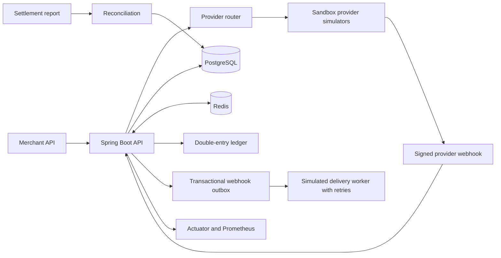

# PayRoute

PayRoute is a sandbox payment orchestration and reconciliation service for Indian merchants. It demonstrates provider selection, replay-safe payment requests, recovery from transient failures, signed provider webhooks, a double-entry ledger, settlement reconciliation, and operational metrics.

All providers are deterministic simulators. PayRoute does not connect to banks, card networks, UPI, or live payment gateways and never moves real money. Amounts are integer paise and the service accepts INR only.

## Run the demo

Requirements: Docker Desktop or Docker Engine with Compose. The API, PostgreSQL, and Redis start together:

```powershell
docker compose up --build
```

Wait for `app` to report that it started, then in a second PowerShell window run:

```powershell
./scripts/demo.ps1
```

The API listens on `http://localhost:8080`. PostgreSQL and Redis are bound to localhost ports `5433` and `6380` so they do not collide with common local installations. Health and Prometheus metrics are available at `/actuator/health` and `/actuator/prometheus`. Compose uses local-only demo credentials; set `PAYROUTE_API_KEY`, `PAYROUTE_WEBHOOK_SECRET`, and `POSTGRES_PASSWORD` before exposing the service beyond localhost. Stop the stack with `docker compose down`; remove demo state with `docker compose down -v`.

To run tests on a machine with Java 21, use `./mvnw.cmd test` in PowerShell or `./mvnw test` on macOS/Linux. The checked-in Maven Wrapper downloads a checksum-pinned Maven distribution. Unit tests and an H2 schema smoke test run without Docker; the PostgreSQL 17 lifecycle suite uses Testcontainers and is skipped when Docker is unavailable.

## Demo outcomes

The script creates a successful UPI payment and replays it with the same idempotency key, routes a transient failure to a second provider, resolves a timed-out payment with a signed webhook, refunds part of a captured card payment, and imports a settlement report containing an orphan transaction. It prints the resulting IDs and analytics response so the measured outcome comes from the running database, rather than a fixed benchmark claim.

On a fresh local Compose database, the checked demo run produced:

| Measured result | Value |
|---|---:|
| Payments completed | 3 of 3 |
| Provider attempts | 4, including one retryable failure and one webhook-resolved timeout |
| Provider fees | 99 paise |
| Estimated savings vs. the highest-fee eligible route | 11 paise |
| Settlement rows | 1 matched and posted to the ledger; 1 provider-only exception |
| Simulated webhook deliveries | 4 delivered after 2 attempts each |
| Outstanding delivery retries | 0 |

This sample describes one deterministic sandbox run with the seeded provider profile and fee rules. The router updates provider health as outcomes arrive, so subsequent runs can choose different routes and report different values. The 100% payment success in this small run describes its scripted outcomes only.

The overview reports observed attempt counts, provider success and latency, payment success rate, provider fees, estimated fee savings, unresolved reconciliation rows, and pending webhook deliveries. When a webhook resolves a timeout, the attempt keeps its original `TIMEOUT` result and records its final `resolvedOutcome`; provider reliability treats unresolved timeouts as unknown until they are confirmed. Estimated savings compare the chosen provider fee with the highest fee among eligible providers for those same payments. This is a transparent counterfactual for the demo, not a guaranteed production saving.

## Design



### Routing

Eligible providers are ordered by a weighted score:

`0.45 × normalized fee + 0.35 × (1 − success rate) + 0.15 × normalized p95 latency + 0.05 × preference penalty`

Provider fee normalization compares the calculated paise fee, including any fixed component, with the highest eligible provider fee for that payment. Latency is capped at 1,000 ms for scoring. Provider reliability and latency start from the sample provider catalog and update after every simulated attempt; Redis caches the latest snapshot and PostgreSQL remains the durable source. A merchant can submit an ordered `preferredProviders` list. Provider cost and merchant pricing are separate values.

The retry policy retries a retryable provider error on the next eligible route. A decline is terminal. A timeout stays `PROCESSING` because the provider's result is unknown; a later signed webhook resolves it. Production adapters would need provider-specific request signing, timeouts, circuit breakers, durable dispatch, and rules for provider-side idempotency before they could replace these simulators.

### Consistency and ledger

- PostgreSQL unique constraints enforce payment idempotency by `(merchant_id, idempotency_key)` and event deduplication by `(provider_code, provider_event_id)`. Redis reduces same-key races with a short lease; database constraints remain authoritative if Redis is unavailable.
- Payment state, routing attempts, ledger entries, and the outbound webhook record commit in the same database transaction. Refunds lock the payment row before checking the remaining refundable amount.
- Capture posts balanced entries for provider clearing, provider processing expense, merchant payable, and platform fee revenue. A matched settlement posts bank cash against processor clearing once per provider reference. Refunds post balanced merchant payable, refund liability, and cash payout entries and add a `payment.refunded` outbox event. Currency and value are stored in paise to avoid floating point money arithmetic.
- Incoming provider webhooks use HMAC-SHA256 over the exact raw request body and a constant-time signature comparison. Only supported terminal payment events advance a pending payment; repeated or stale events are acknowledged without posting a second ledger transfer.
- Merchant notifications use a PostgreSQL outbox with exponential retry delays and a dead-letter state. The receiver is simulated as `success`, `flaky-once`, or `always-fail`; no arbitrary callback URL is fetched.

### Fees and UPI scenarios

`fee_rules` stores merchant-specific or default method pricing with effective dates, basis points, and a fixed paise fee. The seeded UPI rule is an **illustrative zero-MDR scenario for local testing**, not current legal, regulatory, or commercial advice. Rules can be added through the API without changing code:

```http
POST /api/v1/fee-rules
X-API-Key: local-demo-key
Content-Type: application/json

{"ruleName":"Merchant pilot UPI pricing","merchantId":"merchant-42","paymentMethod":"UPI","rateBps":0,"fixedFeeMinor":0,"activeFrom":"2026-10-13T00:00:00Z","enabled":true}
```

An active merchant-specific rule takes precedence over the default rule for that payment method. The current sample rules and provider prices are seeded in `src/main/resources/db/migration/V1__payroute_core.sql` and can be changed through the authenticated API.

## API surface

Every `/api/v1` endpoint except provider webhooks requires `X-API-Key`. Webhooks use `X-Signature` instead.

| Method | Endpoint | Purpose |
|---|---|---|
| `POST` | `/api/v1/payments` | Create a sandbox payment. Requires `Idempotency-Key`. |
| `GET` | `/api/v1/payments/{id}` | Read current payment state and attempts. |
| `POST` | `/api/v1/payments/{id}/refunds` | Create a full or partial simulated refund. Requires `Idempotency-Key`. |
| `GET` | `/api/v1/payments/{id}/ledger` | Inspect the payment's ledger postings. |
| `GET`, `PUT` | `/api/v1/providers`, `/api/v1/providers/{code}/config` | Inspect or update a provider's enabled state and price. |
| `GET`, `POST` | `/api/v1/fee-rules` | Inspect or add effective-dated merchant pricing. |
| `GET` | `/api/v1/settlements` | Inspect imported settlement records and ledger-posting state. |
| `POST` | `/api/v1/webhooks/{providerCode}` | Receive signed sandbox provider events. |
| `GET`, `POST` | `/api/v1/webhook-deliveries`, `/api/v1/webhook-deliveries/{id}/retry` | Inspect the outbox and request an immediate retry. |
| `POST`, `GET` | `/api/v1/reconciliation/runs`, `/api/v1/reconciliation/runs/{id}` | Import settlement rows and inspect discrepancies. |
| `GET` | `/api/v1/analytics/overview` | Inspect payment, routing, reconciliation, and delivery metrics. |

Payment body fields: `merchantId`, `amountMinor`, `currency` (defaults to `INR`), `paymentMethod` (`UPI`, `CARD`, or `NETBANKING`), optional ordered `preferredProviders`, and optional `simulationScenario` (`SUCCESS`, `DECLINE`, `TRANSIENT_FAILURE`, `TIMEOUT`). Use integer paise, for example `12500` means ₹125.00.

Sample payment:

```http
POST /api/v1/payments
X-API-Key: local-demo-key
Idempotency-Key: order-9001
Content-Type: application/json

{"merchantId":"merchant-42","amountMinor":12500,"currency":"INR","paymentMethod":"UPI","simulationScenario":"SUCCESS"}
```

Settlement rows use gross transaction `amountMinor` and provider `feeMinor`, both in paise. Reconciliation marks exact matches and identifies amount/fee mismatches, provider mismatches, missing internal rows, and provider-only transactions.

## Configuration

| Variable | Default | Use |
|---|---|---|
| `PAYROUTE_API_KEY` | `local-demo-key` | Merchant and operations API authentication |
| `PAYROUTE_WEBHOOK_SECRET` | `local-webhook-secret-change-me` | Shared HMAC key for sandbox webhook examples |
| `PAYROUTE_WEBHOOK_DELIVERY_MODE` | `flaky-once` | `success`, `flaky-once`, or `always-fail` simulated receiver |
| `POSTGRES_PASSWORD` | `local-payroute-db` | Local PostgreSQL password |
| `PAYROUTE_RETRY_BASE_SECONDS` | `2` | First simulated delivery retry delay; later delays double |

## Scope and next production steps

This project is a credible local demonstration, not a payment processor or production-ready financial system. It intentionally uses a single service and database, stores no card or bank credentials, has one demo API key, and uses simulated gateways and webhook receivers. Before connecting a live provider, add merchant-scoped authentication and key rotation, secrets management, provider-specific sandbox verification, settlement file ingestion and signatures, ledger close controls, operational alerting, and load/failure testing against the actual database and provider contracts.
